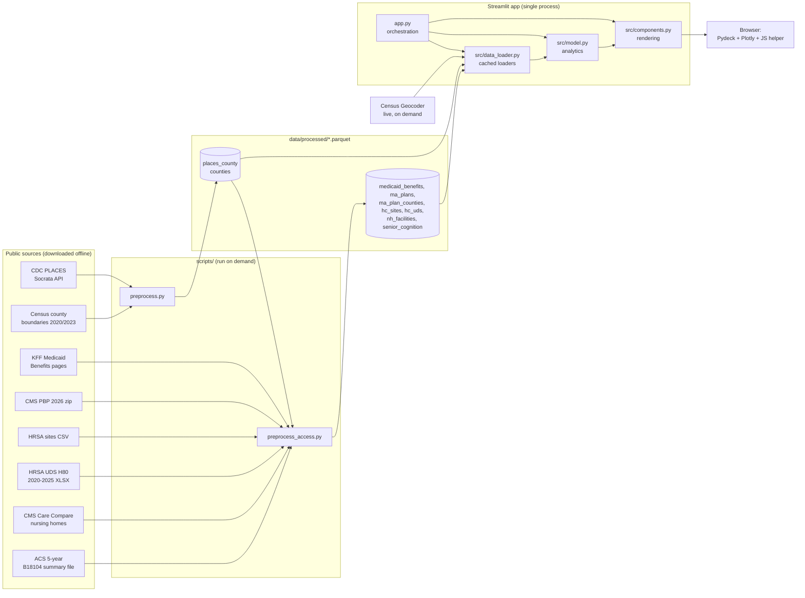

# Cognimap IQ: Technical Architecture

This document describes how the dashboard is built: data sources, the offline pipeline, the runtime design, the analytics and the main design decisions. The problem statement, objectives and target users are in [`project_architecture.md`](project_architecture.md); coding rules are in [`claude.md`](claude.md); usage is in [`README.md`](README.md).

## 1. Scope and constraints

- **Purpose:** a GIS decision-support prototype linking sensory impairment (vision, hearing, mastication) to cognitive decline at county level, plus local care access (Medicaid, Medicare Advantage, health centers, nursing homes), to support shifting budgets toward preventative sensory care.
- **Prototype data:** US public data (CDC PLACES and companions) stand in for Canadian longitudinal data (CCHS, CLSA) and US counties stand in for Canadian health regions.
- **Constraints (from `claude.md`):**
  - single-process, serverless Streamlit app; no database or backend service
  - every runtime read is a local Parquet / GeoParquet file loaded through `@st.cache_data`; raw CSV/XLSX is only read by the preprocessing scripts
  - all geometry in `EPSG:4326` (pattern geometry is built in `EPSG:3857` and converted back)
  - business logic, modelling and rendering live in separate modules

## 2. System overview

`preprocess_access.py` reads the PLACES snapshot (county names and FIPS) to match the other sources to counties, so it runs after `preprocess.py`.

## 3. Offline data pipeline

### 3.1 `scripts/preprocess.py`

1. Downloads the PLACES county releases 2023, 2024 and 2025 (BRFSS 2021 to 2023) for `VISION`, `HEARING`, `TEETHLOST`, `COGNITION`, both age-adjusted and crude values.
2. Pivots to one row per county, year and value type; back-fills the adult (18+) population for the 2023 release from the county's adult share in later releases.
3. Downloads the 1:20M cartographic county files for 2023 and 2020 and keeps every 2023 feature plus the 2020 features whose FIPS no longer exist (legacy Connecticut counties, retired areas). Geometry is simplified and reprojected to `EPSG:4326`.

### 3.2 `scripts/preprocess_access.py`

| Step | Source | Processing |
|---|---|---|
| 1 | KFF state indicator pages | Parses the `gdocsObject` table JSON embedded in each page; keeps the latest survey (2018) for adult dental, eyeglasses and hearing aids. |
| 2 | CMS PBP 2026 | Individual (non-employer) Medicare Advantage plan types only. Benefit flags: dental preventive (16b) / comprehensive (16c) when a benefit type is filled, eyewear (17b), eye exams (17a), hearing aids (18b), hearing exams (18a). Service areas from `PlanArea.txt` (local plans) and `PlanRegionArea.txt` (regional PPOs expanded to every county of the named states). |
| 3 | HRSA service delivery sites | Service delivery sites only (pure administrative sites dropped), with county FIPS, setting, location type and hours. |
| 4 | HRSA UDS awardee files 2020 to 2025 | Table 5 (dental and vision visits / patients) and Table 6A (oral exams, sealants, fluoride, oral surgery, eye exams) per awardee and year. `---` (withheld) becomes missing. 2019 and earlier use different field codes and are excluded. |
| 5 | CMS Care Compare (Provider Data Catalog) | File URLs change each release, so the latest CSV is resolved from the metastore API by dataset id. Provider information, the seven dementia-related MDS measures (four-quarter averages) and counts of F744, F758 and F605 health citations per facility. |
| 6 | ACS 2023 5-year table-based summary file B18104 | Adults 65+ and those with a cognitive difficulty (65 to 74 and 75+, male and female) per county. The ACS API now requires a key; the summary file does not. |

**County matching** (PBP and nursing homes list SSA county codes and names, not FIPS):

- names are normalised (accents and mojibake repaired, "Saint" to "St", suffixes such as County / Parish removed);
- PLACES names independent cities like their namesake county (Fairfax is both 51059 and 51600), so "X City" picks the FIPS with county code ≥ 500 and plain "X" the county;
- nursing homes use the name first, then the SSA code through an SSA-to-FIPS crosswalk built from the PBP service-area file, which lists SSA codes next to full names;
- Connecticut nursing homes are mapped from planning-region abbreviations by hand; DC is fixed. Unmatched records are printed (territories only).

### 3.3 Snapshot (`data/processed/`)

| File | Grain | Key columns | Rows |
|---|---|---|---|
| `places_county.parquet` | county × year × value type | `fips`, `year`, `value_type`, four measures, `adult_population`, `lat`, `lon` | 18,860 |
| `counties.parquet` | boundary feature (GeoParquet) | `fips`, `statefp`, `vintage`, `current`, `geometry` | 3,230 |
| `medicaid_benefits.parquet` | state × benefit | `state`, `benefit`, `covered`, `copay`, `limits`, `prior_approval` | 153 |
| `ma_plans.parquet` | MA plan segment | `bid_id`, `plan_type`, `snp`, benefit flags | 5,557 |
| `ma_plan_counties.parquet` | plan × county | `bid_id`, `fips` | 133,245 |
| `hc_sites.parquet` | health center site | `bhcmis_id`, `fips`, `setting`, `location_type`, `lat`, `lon` | 18,109 |
| `hc_uds.parquet` | awardee × year | `bhcmis_id`, `year`, service counts | 8,196 |
| `nh_facilities.parquet` | nursing home | `ccn`, `fips`, `beds`, `residents`, MDS measures, citation counts, ratings | 14,690 |
| `senior_cognition.parquet` | county | `fips`, `pop65`, `cog65`, `cog65_rate` | 3,222 |

The snapshot (about 4.6 MB) is committed; raw downloads (about 470 MB) stay in the git-ignored `data/raw/`.

## 4. Runtime architecture

### 4.1 Modules

| Module | Responsibility |
|---|---|
| `app.py` | Page setup, cached analytics wrappers, year / playback state, profile selection rules, tab layout and wiring of components. |
| `src/config.py` | Paths, measure labels and descriptions, colour ramps and overlay styles, risk tiers, policy timeline, care-access indicator labels, sources. |
| `src/data_loader.py` | Cached Parquet loaders, per-year geometry (resolves boundary vintage changes), selection bounds and outlines, Census geocoder, hatch / dot pattern geometry. |
| `src/model.py` | SORI, OLS association model, scenario, summaries, priority ranking, MA plan shares, health center and UDS aggregation, nursing home summaries. Pure pandas / numpy, no Streamlit calls. |
| `src/components.py` | Sidebar and controls, KPI cards, Pydeck map and layers, Plotly charts, tables, the County profile panels, and the injected JavaScript helper. |

### 4.2 Execution and caching

Streamlit reruns `app.py` top to bottom on every interaction. Expensive work is memoised with `@st.cache_data`:

| Cache | Content |
|---|---|
| loaders in `data_loader` | each Parquet file, per-year geometry and GeoJSON, outlines, pattern geometry (keyed by FIPS tuple and spacing) |
| `model_fits(value_type)` | one OLS fit per year |
| `scored_panel(value_type, weights)` | SORI and model outputs for every county-year, per weighting |
| `plan_shares()` | per-county MA benefit shares |
| `nursing_home_summaries()` | nursing home summaries by county, state and US |
| `geocode_address` | live geocoder responses (24 h TTL) |

A rerun therefore mostly slices cached frames and rebuilds figures.

### 4.3 Session state

| Key | Purpose |
|---|---|
| `year`, `playing`, `_play_started` | analysis year and timeline playback (advances one year per rerun, 1.6 s apart) |
| `lookup_address`, `lookup` | sidebar address lookup and its result |
| `main_tab` | active tab (keyed tabs with `on_change="rerun"`, so code can switch tabs) |
| `profile_state`, `profile_fips` | County profile selection |
| `_profile_priority` | the region / year / weights the profile default was seeded for |
| `_map_nonce` | suffix of the map widget key, bumped after a click to clear the selection |
| `uds_service`, `uds_org` | UDS history pickers |

### 4.4 Profile selection rules

1. The profile defaults to the alphabetically first state and county (Alabama, Autauga County).
2. A manual pick is kept across region, year and weight changes; it falls back to the default only if that county has no estimate for the selected year.
3. A map click selects that county and switches to the profile tab.
4. A successful address lookup offers a "Looked-up" shortcut button instead of switching automatically.

## 5. Analytics

- **SORI.** For each sensory measure `z = (x - mean) / sd` over all county-years; `index = Σ wᵢ zᵢ` with weights normalised to 1; `SORI = percentile rank of index × 100` over all county-years. Tiers: Critical ≥ 90, High ≥ 75, Elevated ≥ 50, else Baseline.
- **Association model.** Per year, `COGNITION ~ VISION + HEARING + TEETHLOST` by OLS (numpy least squares) with standard errors, standardised β, R² and Pearson r. Predictions and residuals feed the priority table.
- **Scenario.** A relative reduction rᵢ in each sensory rate changes predicted prevalence by `-Σ xᵢ rᵢ max(βᵢ, 0)`; adults averted = `Σ (baseline - scenario) / 100 × adults`. Only positive coefficients are credited.
- **Headline statistics.** Rates are adult-population-weighted, `Σ rate × adults / Σ adults`; the average SORI is a simple mean of county scores.
- **Medicare Advantage.** Per county, plans offering a benefit / plans offered; compared with the median of county shares in the state and in the US.
- **Health centers.** UDS is reported per organisation. The county summary multiplies each organisation's count by `sites in county / all sites` and sums. A year is drawn as a line only when every organisation published it; partial years are open markers (understated, not comparable).
- **Nursing homes.** Quality measures are weighted by average daily residents (falling back to beds); citations are per home; beds per 100 at-risk seniors = `certified beds / adults 65+ with a cognitive difficulty × 100`. State and US values use the same method. Comparisons count as similar within ±10% of the reference; otherwise worse / better follows each indicator's direction (lower is better except star rating and RN hours).
- **Findings.** A *dementia-care priority* is flagged when the 65+ cognitive difficulty rate is above the US county median and long-stay antipsychotic use is more than 10% above the US; a *capacity gap* when the burden is above median and beds per 100 at-risk seniors are more than 10% below the US.

## 6. Map and charts

- **Choropleth.** Quantile class breaks are computed on the pooled distribution of all years, so the same colour means the same value at every step of the slider. Counties outside the selected states are dimmed; selected states and the looked-up county get black outlines (states are dissolved with a grow-union-shrink buffer to remove seams).
- **Overlay patterns** are real geometry: 45° hatch lines clipped to each county and a staggered dot grid, built in Web Mercator so they stay aligned across neighbouring counties. Spacing is in screen pixels for the initial zoom (dots widen to 7 px on the national view), counties too small for the grid get one dot, and patterns are only built near the initial viewport.
- **View fitting.** The initial view is computed from the selection's bounds in Web Mercator for the map's pixel size.
- **pydeck strings.** pydeck turns string arguments into accessors, so literal values are double-quoted (`'"pixels"'`).
- **Line-end labels.** Labels sit in one column at the last year, are spread vertically to at least 15 px apart, take their line's colour, and live in a reserved right margin so narrow charts do not clip them.

## 7. Browser-side helper

`install_tooltip_placement()` injects one script with `st.html(..., unsafe_allow_javascript=True)`:

- **Tooltip placement.** deck.gl positions its tooltip at a fixed offset (and the y offset is wrong inside Streamlit), while the map container clips overflow. The script tracks the real pointer and re-places `.deck-tooltip` above the cursor, below it near the top edge, and always inside the map.
- **Double-click guard.** Map selection toggles, so a double-click would select and immediately deselect a county before Streamlit sees it. The script swallows a second press at the same spot within 500 ms.
- **Map click.** The Pydeck chart uses `on_select` with a single-object selection; the callback stores the clicked FIPS and state, switches `main_tab` to the profile and bumps `_map_nonce` so the map comes back without a lingering selection. Double-click zoom is disabled on the map view.

## 8. Known limitations

- **Ecological design.** County-level, cross-sectional comparisons; they indicate where to look, not individual-level or causal effects.
- **Data vintage and coverage.** KFF Medicaid benefits are from 2018. Many UDS Table 5 values are withheld, especially before 2022, and UDS has no hearing services line. CMS PBP lists Connecticut by legacy counties, which cannot be mapped to planning regions. ACS cognitive difficulty is self- or proxy-reported, not diagnosed dementia, with wide margins of error in small counties. US territories are not covered.
- **UDS site allocation** uses today's site list for every year.
- **Streamlit coupling.** The JavaScript helper depends on Streamlit's DOM (`.deck-tooltip`, `stDeckGlJsonChart`); recheck tooltip placement and double-click behaviour after upgrading Streamlit.
- **Label spacing** assumes an approximate plot height; very narrow windows can bring labels closer.

## 9. Path to Canadian data

1. Replace `scripts/preprocess.py` with a CCHS / CLSA pipeline that writes the same `places_county` schema (geography id, year, the four measures, adult population), keyed by health region instead of county FIPS.
2. Swap the boundary file for health-region boundaries in `EPSG:4326`; `year_geometry` already handles boundary changes between years.
3. Replace the US care-access sources with provincial equivalents (dental, vision and hearing coverage; community health centres; long-term care homes) behind the same `CountyAccess` / `NursingHomes` structures.
4. Update `POLICY_EVENTS` with provincial and health-region interventions.
